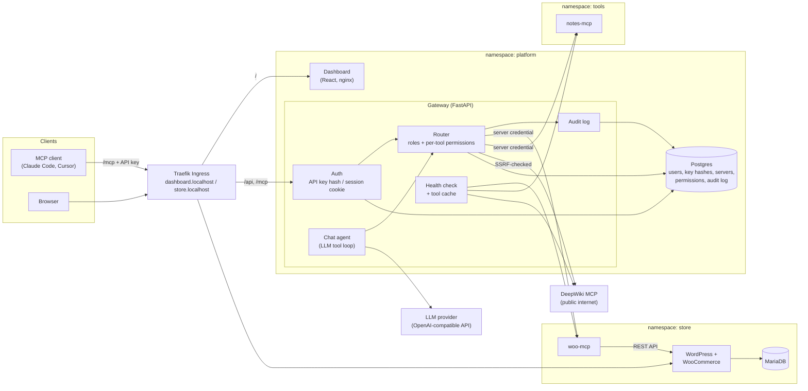

# Team MCP Gateway on Kubernetes

One MCP endpoint for a whole team: an admin connects MCP servers once, and every member uses all of their tools
from Claude Code, Cursor or a built-in chat agent, with per-user keys, role-based tool permissions and an audit log.

> Built as a take-home assignment (Urumi AI, Forward Deployed Engineer internship, round 1): a WooCommerce
> store on Kubernetes with a team MCP gateway in front of it. Developed with AI assistance (Claude Code).

## Overview

MCP servers give AI assistants tools, but each server has its own URL and credential, and every person has to
configure every server. Sharing those credentials across a team means nobody knows who did what, and anyone can
use every tool.

This project puts a gateway in front of the servers:

- **One endpoint.** Members point their MCP client at the gateway with their own API key and get the tools of
  every enabled server, named `<server>__<tool>`.
- **Credentials stay on the server.** The gateway adds each upstream's credential itself; members never see it,
  and their own key is never forwarded upstream.
- **Control and accountability.** Admins enable, disable and restrict servers and tools; every tool call is
  audited under the user who made it.

The repository also contains a WooCommerce store, an MCP server for it written from scratch, a second in-cluster
MCP server, and Helm charts that deploy everything to a local k3d cluster or a k3s server.

## Key features

| Feature | Where |
|---|---|
| Single MCP endpoint (Streamable HTTP, stateless JSON) aggregating 3 upstream servers and 12 tools | `services/gateway/app/mcp_endpoint.py`, `router.py` |
| Name-collision-safe routing: `<slug>__<tool>`, slugs cannot contain `_` | `router.py` (`exposed_name`, `call_tool`) |
| Cached tool lists from a background health check, so a slow or dead upstream never blocks listing | `health.py`, `router.py` (`routable_tools`) |
| Per-call timeouts (30 s) and clear `timeout` / `unreachable` / `error` results; dead servers marked Unreachable immediately | `upstream.py`, `router.py` |
| Per-user API keys (shown once, stored as SHA-256 hashes, revocable) | `security.py`, `api.py` |
| Two roles (admin, member) and per-tool permissions: admin-only tools are hidden from members and refused if called | `router.py`, `db.py` (`AdminOnlyTool`) |
| Audit log of every tool call: user, source, server, tool, duration, outcome | `audit.py`, `db.py` (`AuditLog`) |
| Chat agent with an LLM tool loop that acts as the signed-in user, through the same routing and audit path | `chat.py` |
| SSRF guard on upstream URLs (checked on save and before every connection) | `ssrf.py` |
| React dashboard: servers, chat, API keys, team and invites, audit log | `dashboard/src/pages/` |
| WooCommerce MCP server: products and orders through the WooCommerce REST API (5 tools) | `services/woo-mcp/` |
| Helm charts with local and production values, default-deny NetworkPolicies, probes and limits on every workload, automatic rollback of failed upgrades | `charts/`, `Makefile` |

## Architecture



Each namespace denies all incoming traffic by default; only gateway pods can reach the MCP servers and Postgres.
The full design (how a tool call travels, failure handling, tradeoffs) is in [docs/DESIGN.md](docs/DESIGN.md).

## Tech stack

| Area | Technology |
|---|---|
| Gateway | Python 3.12, FastAPI 0.143, Uvicorn, MCP Python SDK 1.30, SQLAlchemy 2.1 (async), httpx, pydantic-settings |
| MCP servers | Python, MCP SDK (FastMCP), WooCommerce REST API (v3) |
| Dashboard | React 19, Vite 8, served by nginx-unprivileged |
| Data | Postgres 16 (gateway), MariaDB 11.4 (store), SQLite in tests |
| Store | WordPress (PHP 8.3, Apache), WooCommerce, wp-cli setup job |
| Platform | Kubernetes (k3d locally, k3s for production), Helm 4, Traefik, cert-manager (production TLS) |
| Tooling | Make, Docker, GitHub Actions |

## Quickstart

### Requirements

Docker, [k3d](https://k3d.io), kubectl, [Helm](https://helm.sh), openssl and make. On Windows, run everything in
WSL 2 (Ubuntu) with Docker Desktop's WSL integration enabled. About 4 GB of free memory.
Tested with k3d 5.9.0 (k3s v1.35.5), Helm v4.3.0.

```bash
make tools          # checks the tools above are installed and Docker is running
```

### Run on a local Kubernetes cluster (k3d + Helm)

```bash
git clone https://github.com/Samyak-b/urumi-mcp-gateway.git
cd urumi-mcp-gateway
cp .env.example .env    # optional: fill in LLM_BASE_URL, LLM_MODEL, LLM_API_KEY for the chat agent
make up                 # cluster, secrets, image builds, Helm lint and deploy (about 10 minutes the first time)
make creds              # prints the dashboard and WordPress logins
```

Then open:

- http://dashboard.localhost: the gateway dashboard (sign in with the credentials from `make creds`)
- http://store.localhost: the WooCommerce storefront

`*.localhost` resolves to your own machine in browsers, so no hosts-file changes are needed.
After a code change: `make build import deploy`. To start over: `make down && make up`.

### Connect an MCP client

In the dashboard, open **Connect a client**, create an API key, then for example:

```bash
claude mcp add --transport http team-gateway http://dashboard.localhost/mcp \
  --header "Authorization: Bearer <your key>"
```

### Run without Kubernetes (tests only)

There is no standalone run mode. The end-to-end test starts the real gateway and MCP servers in one container,
with fakes for WooCommerce and the LLM:

```bash
make build    # once, builds the images
make test
```

### Production-like server (k3s)

The same charts with `values-prod.yaml` (`make values-diff` shows every difference). This path has been linted
and rendered but not yet run on a server.

1. A Linux server with 2 vCPUs, 4 GB RAM, ports 80/443 open, and DNS records for the store and dashboard hosts.
2. Install k3s and copy its kubeconfig to your machine (replace `127.0.0.1` with the server address):
   ```bash
   curl -sfL https://get.k3s.io | sh -
   sudo cat /etc/rancher/k3s/k3s.yaml
   ```
3. Install cert-manager and the Let's Encrypt issuer (set your email in `deploy/prod/cluster-issuer.yaml` first):
   ```bash
   export KUBECONFIG=~/.kube/vps.yaml
   helm install cert-manager cert-manager --repo https://charts.jetstack.io -n cert-manager --create-namespace --set crds.enabled=true
   kubectl apply -f deploy/prod/cluster-issuer.yaml
   ```
4. Push the four images to a registry the server can pull from, and set them in the `values-prod.yaml` files.
5. Set your hosts in `charts/store/values-prod.yaml` and `charts/platform/values-prod.yaml`.
6. Generate secrets and deploy:
   ```bash
   make secrets
   KUBECONFIG=~/.kube/vps.yaml make lint deploy ENV=prod
   ```

### Upgrades and rollback

Every `make deploy` is a Helm revision per release and rolls back automatically if it doesn't become ready.
`make history` lists revisions, `make rollback RELEASE=<store|notes|platform> [REVISION=n]` goes back, and
`make backup` dumps both databases before a store upgrade (WordPress and WooCommerce migrate their schema, which a
rollback can't undo).

## Configuration

Hand-filled settings go in `.env` (git-ignored). Passwords and tokens are never written by hand:
`make secrets` generates them into `deploy/secrets/` (git-ignored), and Helm delivers them as Kubernetes Secrets.

`.env`:

| Variable | Purpose |
|---|---|
| `LLM_BASE_URL` | OpenAI-compatible API base URL for the chat agent, e.g. `https://api.example.com/v1` |
| `LLM_MODEL` | model name; must support tool calling |
| `LLM_API_KEY` | API key for that provider (stored as a Kubernetes Secret) |
| `ADMIN_EMAIL` | email of the first dashboard admin |

Gateway environment (set by the Helm chart from values and Secrets; defaults in `services/gateway/app/config.py`):

| Variable | Default | Purpose |
|---|---|---|
| `DATABASE_URL` | SQLite file | Postgres URL in the cluster |
| `SESSION_SECRET` | none (required) | signs dashboard session cookies |
| `ADMIN_EMAIL`, `ADMIN_PASSWORD` | `admin@example.com`, none | first admin, created when there are no users |
| `PUBLIC_URL` | `http://dashboard.localhost` | shown MCP URL and invite links |
| `COOKIE_SECURE` | `false` | HTTPS-only cookie in production |
| `SEED_SERVERS` | `[]` | JSON list of servers registered on first start (from a Secret) |
| `INTERNAL_UPSTREAM_HOSTS` | empty | host names allowed to resolve to internal addresses (SSRF allow-list) |
| `UPSTREAM_CALL_TIMEOUT_S` / `UPSTREAM_PROBE_TIMEOUT_S` | `30` / `5` | per tool call / per health check |
| `HEALTH_INTERVAL_S` | `10` | health check interval |
| `MAX_BODY_BYTES` | `1000000` | largest `/mcp` request |
| `LLM_BASE_URL`, `LLM_MODEL`, `LLM_API_KEY` | empty | chat agent provider |
| `LLM_TIMEOUT_S` / `CHAT_MAX_STEPS` | `60` / `8` | LLM call timeout / tool-loop rounds per message |
| `STORE_TIMEZONE` | `UTC` | the chat agent's notion of "today" |

MCP servers: `MCP_TOKEN` (bearer token the gateway must present), `PORT`, `LOG_LEVEL`; woo-mcp also
`WOO_BASE_URL`, `WOO_CONSUMER_KEY`, `WOO_CONSUMER_SECRET`, `STORE_PUBLIC_URL`, `STORE_TIMEZONE`.

## Security model

- **Authentication.** Dashboard: signed HttpOnly session cookie, plus a required custom header on every write
  (CSRF). MCP clients: per-user API keys, stored as SHA-256 hashes and checked on every request; revoking a key
  takes effect on the next request. Passwords: scrypt with a per-user salt. Invites: single-use, 7 days, hashed.
- **Roles.** `admin` manages servers, members, keys and permissions and sees the whole audit log; `member` uses
  tools, manages their own keys and sees their own audit rows.
- **Per-tool permissions.** Any tool can be made admin-only. Members are not offered it (MCP clients and chat) and
  a direct call is refused and audited as `denied`. A fresh install locks WooCommerce's write tools.
- **Credential isolation.** Upstream credentials are write-only through the API, added by the gateway on the
  server side, never sent to browsers or MCP clients; client keys are never forwarded upstream.
- **SSRF protection.** Upstream URLs that resolve to private, loopback, link-local (cloud metadata) or other
  internal addresses are refused unless the host is on an operator-controlled allow-list in Helm values; checked
  on save and before every connection; redirects are not followed.
- **Network isolation.** Default-deny NetworkPolicies; only gateway pods reach the MCP servers and Postgres, and
  the MCP servers also require a bearer token. Only the two Ingress hosts are public.
- **Containers.** Gateway, dashboard and MCP server images run as non-root with a read-only root filesystem and
  no Linux capabilities; MariaDB and Postgres run as non-root; no pod gets a Kubernetes API token.
- **Untrusted upstreams.** Tool descriptions and results are length-capped and prefixed with their server's name,
  and the chat agent is instructed to treat them as data.

The full threat model is in [docs/THREAT_MODEL.md](docs/THREAT_MODEL.md).

## Testing

| Command | What it covers |
|---|---|
| `make test` | 47 end-to-end checks without Kubernetes: the real gateway and MCP servers with fakes for WooCommerce, a slow server and a scripted LLM. Routing and name collisions, timeouts, dead upstreams, revoked keys, tool permissions, SSRF guard, credential isolation, chat as the user, audit log. Runs in GitHub Actions |
| `make smoke` | The full flow with two users against the live cluster (up to 27 checks; `SKIP_CHAT=1` skips the 7 that need the LLM): store order, chat, external MCP client, two-server task, permissions, disable, killed pod, revoked key, audit attribution |
| `make isolation` | Which pods can reach which internal services (NetworkPolicies) |
| `make workloads` | Probes, requests and limits on every workload |
| `make secrets-check` | No generated secret appears in any tracked file or in git history |
| `make values-diff` | Everything that differs between local and production values |
| `make rollback-check` | A failed upgrade rolling itself back, and rollbacks with no data lost |

CI (`.github/workflows/ci.yml`) runs the end-to-end test, Helm lint with both value sets plus a secret scan, and
image builds on every push.

## Project structure

```
services/
  gateway/        FastAPI gateway: /api (dashboard), /mcp (MCP endpoint), routing, health checks, audit, chat agent
  woo-mcp/        MCP server for WooCommerce (REST API)
  notes-mcp/      small team-notes MCP server
dashboard/        React dashboard (Vite)
charts/
  store/          WordPress, WooCommerce, MariaDB, woo-mcp, setup job
  notes-mcp/      notes-mcp
  platform/       gateway, dashboard, Postgres, Ingress
deploy/           k3d cluster config, production ClusterIssuer
scripts/          secret generation and the checks behind the make targets
tests/            end-to-end test, live-cluster smoke test, fakes
docs/             DESIGN.md, THREAT_MODEL.md
Makefile          every command (make help)
```

## Screenshots


## Roadmap and known limitations

- Not yet deployed to a real server: production values, TLS and steps exist but have only been linted and rendered.
- Upstream credentials are stored in plain text in Postgres (never exposed through the API); encrypting them at
  rest is the next security step.
- No egress NetworkPolicies; WordPress still starts as root (Apache on port 80).
- One gateway replica and no rate limits yet.
- Each tool call opens a new MCP session to the upstream, which costs latency (about 230 ms p50 extra per call
  in a local benchmark); reusing pooled upstream sessions is the planned fix.
- No schema migrations: tables are created if missing.
- Permissions are per role and per tool, not per user or per argument.
- notes-mcp keeps notes in memory.
- A connected MCP client keeps its tool list until it lists again (no `tools/list_changed` push), but disabled or
  admin-only tools are always refused when called.

## License

MIT. See [LICENSE](LICENSE).
